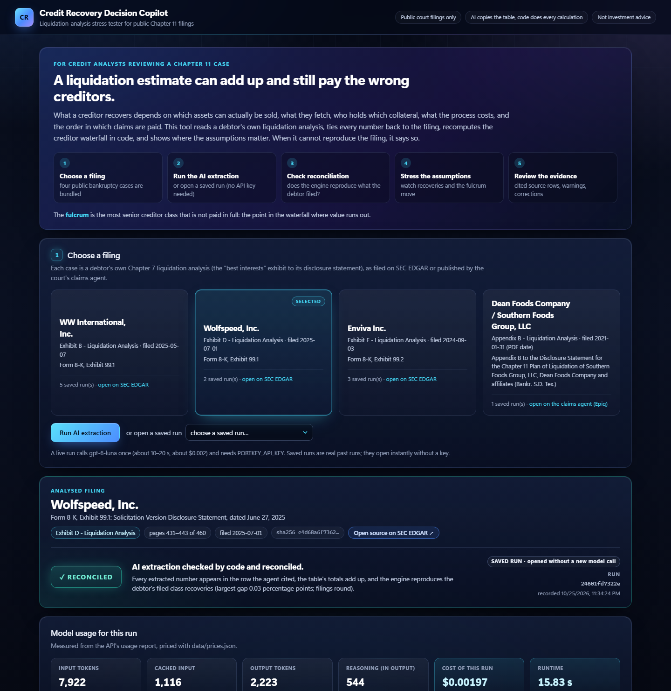

# Credit Recovery Decision Copilot

*A liquidation estimate can add up and still pay the wrong creditors. This tool helps an analyst trace a
bankruptcy liquidation analysis back to the filing, rebuild the creditor waterfall, and see where the assumptions
matter.*

**MGT 409 AI Foundations for Managers · Final project · Tuğrul Özsoy (Yale SOM MBA)**

## Why I built this

While preparing for the UCLA Credit Pitch Competition, I spent a lot of time trying to understand liquidation
recovery for a distressed-credit investment. I expected the work to look like a spreadsheet exercise: take the
company's assets, apply a recovery discount to each, and hand the result to the creditors.

The deeper I went, the less that picture held. What a creditor actually recovers depends on which assets can really
be sold, what they fetch in a distressed sale, which creditors hold security over which collateral, what the
liquidation itself costs, how claims are ranked, how guarantees and legal-entity boundaries cut through the
structure, and how the proceeds pass down the waterfall. Small changes in any of these can move the answer a lot,
or change which creditor class is the one that absorbs the loss.

The part that stayed with me was this: **a model can add up perfectly and still give an economically wrong answer**,
if the waterfall or the structure behind it is wrong. Nothing in the spreadsheet warns you.

So I asked a narrower question: could this fragile, judgment-heavy analysis be made more reproducible, transparent
and auditable, without pretending that AI removes the need for human judgment? This project is my answer. I built it
independently for MGT 409 from public bankruptcy filings only. It uses no competition material and was not used for
any competition submission.

## What I built

Credit Recovery Decision Copilot reads the liquidation analysis that a Chapter 11 debtor files with its disclosure
statement. One AI agent (gpt-6-luna) copies the liquidation table and cites the exact source row for every number;
code checks that each number really is printed there. All the financial math (totals, the priority waterfall,
stress tests) is deterministic Python, never the model. The engine then recomputes the debtor's own scenarios and
compares them with the class recoveries the debtor filed: if they match, the case is marked **RECONCILED**; if not,
it is marked **NEEDS REVIEW** and a person takes over, with every correction logged by name.



*The actual app running locally (a saved real Wolfspeed run). More screenshots of real runs are in
[`docs/screenshots/`](docs/screenshots/).*

## What you can do with it

- **Extract a public filing.** Pick one of four bundled bankruptcy cases (WW International, Wolfspeed, Enviva, Dean
  Foods) and run a live extraction, about 10-25 seconds of model time and about $0.002 per run (the Dean Foods PDF
  takes about 50 seconds end to end).
- **Check whether it reconciles.** See the debtor's filed recovery for each creditor class next to the engine's
  recomputation, with every number tied to its source row.
- **Change the assumptions.** Move asset-recovery and liquidation-cost sliders and watch class recoveries change
  instantly (no model call).
- **See the fulcrum move.** The fulcrum is the most senior creditor class that is not paid in full. In Wolfspeed's
  High case (other assumptions held fixed), cutting plant-and-equipment recovery from the filed 44.8% to 39.5% of book
  already moves the fulcrum from the unsecured notes to the administrative tier; at 13.7% the senior secured notes
  fall from 100% to 83.6% and become the fulcrum.
- **Investigate an honest NEEDS REVIEW.** Enviva and Dean Foods are built from separate legal-entity waterfalls.
  The app extracts them with every number grounded, then shows that one consolidated waterfall cannot reproduce the
  filed recoveries instead of reporting a confident, wrong number.

## How to try it

This repository is the source code; the app is **not hosted online**. It runs on your own computer in a few minutes.
Tested on Windows 11 with Python 3.14; the macOS/Linux commands are standard but were not tested.

**1. Get the code** (needs Python 3.12 or newer and Git)

```bash
git clone https://github.com/tugrul-ozsoy/credit-recovery-copilot.git
cd credit-recovery-copilot
```

**2. Create a virtual environment and install** (about 2-3 minutes)

Windows (PowerShell or Command Prompt):

```bash
python -m venv .venv
.venv\Scripts\activate
pip install -r requirements.txt
```

macOS / Linux:

```bash
python3 -m venv .venv
source .venv/bin/activate
pip install -r requirements.txt
```

**3. Add the API key** (only needed for live extractions)

Create a file named `.env` containing one line, `PORTKEY_API_KEY=...` with your course Portkey key (see
`.env.example`). The app looks for `.env` in the repository folder first, then in the folder above it, so the
course's `submissions/.env` layout works as is. The model is `gpt-6-luna`. Never commit `.env`.

**4. Start the app**

```bash
python -m app.server
```

Then open **http://127.0.0.1:8000** in your browser.

**5. Use it**

1. Choose a filing (WW International is the quickest).
2. Press **Run AI extraction**, or open a saved run from the drop-down.
3. Check section 2, *Filed vs recalculated recoveries*.
4. Move the sliders in section 3, *Stress test the assumptions*.
5. Look at the cited source rows, warnings and corrections in section 4 and the safety panel.

**What works without an API key:** opening the saved runs (real past runs, clearly labelled *SAVED RUN*), stress
tests, corrections, and the tests. Without a key, *Run AI extraction* shows a clear message instead of failing.
You can also just read [`report.html`](report.html) and [`slides.html`](slides.html) (download and open them in a
browser) and the screenshots.

## Verified results

All from real runs and logs in this repository; nothing below is estimated except where stated.

| What | Result | Evidence |
|---|---|---|
| Extraction accuracy where an answer key exists | 7 of 7 live runs fully correct: 5 runs on WW International (108 fields each) and 2 on Wolfspeed (112 each), against hand-keyed keys the model never sees | `output/extractions/`, `app/evaluate.py` |
| Engine vs the debtors' filed recoveries | WW and Wolfspeed reconcile (largest gaps 0.34 and 0.03 percentage points); Enviva and Dean Foods do not, and are flagged | `output/reconciliation.json`, `docs/pilot/dean_foods_live_test.json` |
| Cost and speed | 10 live extractions across 4 filings (5 are WW repeats): $0.0015-$0.0032 and 11.6-21.7 s of model time each; mean $0.0020 per run, $0.0022 and 18 s averaged per filing | `output/usage_log.json` |
| Prompt-injection test | Hidden and visible instructions planted in a WW filing: hidden one withheld, visible one flagged, extraction still 108/108 | `output/injection_test.json` |
| Fresh clone | About 4 minutes from `git clone` to a reconciled live run, with `.env` one folder up, on Windows 11 | `docs/fresh_clone/fresh_clone_test.json` |
| Tests | 39 automated tests, no model calls: `python -m pytest -q` | `tests/` |

**Not established:** how much time this saves an analyst. No timed manual comparison or independent user study has
been completed yet; an earlier user trial was reported but is unverified (see `docs/pilot/user_trial_record.md`).

## How it works

```
public filing ──► locate + sanitize (code) ──► extractor agent (gpt-6-luna) ──► validator (code) ──► engine (code)
                   exhibit pages only;          typed table + a cited            every number in its     priority waterfall;
                   hidden text withheld         source row per number            cited row; totals add   recompute + reconcile
                                                       ▲                          up; ≤1 targeted retry          │
                                                       └──────────────────────────────┘                          ▼
                                                                         RECONCILED  or  NEEDS REVIEW ──► person corrects (logged)
```

| Path | What it is |
|---|---|
| `app/locate.py` | Finds the liquidation exhibit in a 200-460-page EDGAR filing (skipping table-of-contents hits) or a claims-agent PDF |
| `app/sanitize.py` | Withholds hidden text, flags instruction-like phrases, wraps the filing as untrusted data (from HW6) |
| `app/extract.py`, `prompts/extractor.md` | The extractor agent, its output validator and the run logs |
| `app/checks.py` | Grounding, cross-foot and reconciliation checks; RECONCILED or NEEDS REVIEW |
| `engine/schema.py`, `engine/waterfall.py` | Typed liquidation analysis; absolute-priority waterfall, stress overrides, fulcrum |
| `app/review.py`, `app/server.py`, `static/` | Human corrections with provenance; FastAPI app and the single-page interface |
| `app/llm.py`, `app/logs.py` | Portkey / gpt-6-luna model, `.env` lookup, token and cost logging (from HW6) |
| `data/cases/` | The four public filings and hand-keyed answer keys (see `data/cases/README.md`) |
| `output/` | Real run logs: usage and cost, audit trail, extractions, corrections |
| `docs/` | Screenshots, the Dean Foods live test, the user-trial record, the fresh-clone test |
| `report.html`, `slides.html` | Final report and slides, rebuilt from the logs by `scripts/build_report.py` and `scripts/build_slides.py` |

Command-line tools (live model calls where noted):

```bash
python -m pytest -q                                                    # all tests, no model calls
python scripts/reconcile_cases.py                                      # engine vs filed recoveries, no model calls
python -m app.extract data/cases/ww_international/source.htm           # one live extraction
python scripts/extract_eval.py --run ww_international                  # live extraction, then score vs the answer key
python scripts/review_extraction.py output/extractions/<file>.json     # show fields, provenance, warnings
python scripts/injection_live_test.py                                  # live extraction with a planted instruction
```

## Limitations

- **One consolidated waterfall.** Cases built from legal-entity waterfalls or separate collateral pools (Enviva,
  Dean Foods) are flagged NEEDS REVIEW, not solved. Reproducing them needs an explicit map of which entity owns which
  asset and how guarantees and intercompany claims flow, which is exactly where human judgment belongs.
- **What RECONCILED certifies.** It checks the debtor's filed scenarios only. The order among classes that recover
  the same in every filed scenario, classes at 0% everywhere, and the units label come from the extraction and are
  not verified by the filing, but the stress test uses them.
- **Bundled filings only.** The interface analyses the four bundled cases; a new filing needs a folder under
  `data/cases/` (there is no upload screen).
- **Small evaluation set.** Four public cases, answer keys for three, keyed by one person. No claim of general
  extraction accuracy.
- **PDF handling is basic.** No OCR; embedded spreadsheet tables in PDFs are sent as plain text with a visible
  warning.
- **Chapter 7 floor, not a forecast.** A liquidation analysis is the debtor's hypothetical best-interests floor, not a
  prediction of plan recoveries or market prices. Not investment advice.
